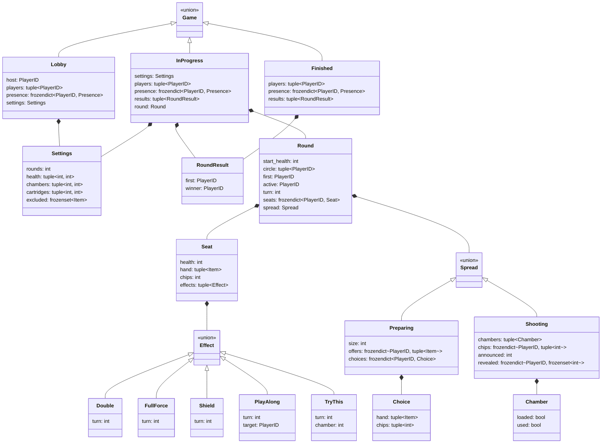

[← Доменный слой](README.md)

# Модель данных

Всё состояние игры — неизменяемые классы (frozen dataclass). Правило не
меняет состояние, а возвращает новое (см. [правила](rules.md)).

## Диаграмма

Стрелка с треугольником — «один из вариантов типа», а не наследование:
`Game = Lobby | InProgress | Finished`, `Spread = Preparing | Shooting`,
`Effect = Double | FullForce | Shield | PlayAlong | TryThis`.

## Игра

| Тип | Когда | Заметки |
| --- | --- | --- |
| `Lobby` | до начала | появляется на первом Join, поэтому хост есть всегда |
| `InProgress` | идёт раунд | |
| `Finished` | игра окончена | команд нет |

- `presence` — `PRESENT` / `AWAY` / `WITHDRAWN`. Пока кто-то `AWAY`, игра
  на паузе (см. [игру](../../../rules/chapters/game.md#потеря-связи)).
- `results` — итог каждого сыгранного раунда: кто начинал и кто выиграл.
- `Settings` — настройки хоста (см. [параметры](../../../rules/parameters.md)).
  Лимит руки — константа, не настройка.

## Раунд

- `start_health` — жизни в начале раунда; потолок для лечащих предметов.
- `circle` — круг, перетасован в начале раунда.
- `first` — первый ходящий; попадает в `RoundResult`.
- `active`, `turn` — чей ход и его номер в раунде. Номер растёт при
  каждой передаче хода и не меняется, когда ряд кончился посреди хода.
- `seats` — место каждого участника раунда.

## Место

- `health` — жизни. Выбывание ставит `0`.
- `hand` — рука.
- `chips` — заработанные фишки, ещё не положенные на каморы.
- `effects` — эффекты, не больше одного каждого вида. `turn` эффекта —
  номер хода, в который он появился; по нему считается срок (см.
  [эффекты](rules.md#эффекты)).

## Ряд

- `Preparing` — начало ряда. `size` — число камор, `offers` — что выпало
  каждому живому, `choices` — решения тех, кто уже решил.
- `Shooting` — ряд заряжен. `chips` — фишки каждого игрока по каморам,
  `announced` — сколько патронов объявлено, `revealed` — каморы, вес
  которых узнал каждый игрок.

## Что не хранится, а вычисляется

| Что | Как |
| --- | --- |
| Живой | `seat.health > 0` |
| Вес каморы | `1 + сумма фишек всех игроков на ней` |
| Счёт побед, сыграно раундов | по `results` |
| Сколько раз игрок начинал раунд | по `results` и текущему `first` |
| Победитель игры | невыбывший с наибольшим числом побед |
